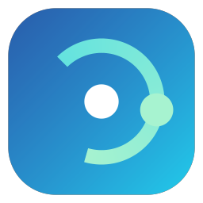

# agbrowser

**agbrowser** 是一个正在完善的精简浏览器：Windows 版使用本机 WebView2 Runtime 提供 Chromium 内核，浏览器窗口、左侧垂直标签和导航由 agbrowser 自己实现。macOS 的 WebKit/Safari 内核适配尚未实现。产品当前仍处于开发阶段。

Windows 窗口使用独立数据，不会自动继承 Chrome/Edge 的账户或登录状态。首次使用需要重新登录；具体网站的嵌入式登录兼容性需要单独验证。收藏栏默认读取 Edge 当前配置的收藏；内置少量广告域名和页面占位隐藏规则，不代表完整过滤列表，网页的内容安全策略也可能限制隐藏效果。

项目还保留一套早期的 Node.js MCP 和宿主浏览器运行时。**它目前不控制独立 Windows 窗口**；旧方案中真实配置目录的链接与调试端口具有安全和并发风险，在本机链接测试也未通过，不能保证继承浏览器账号。下文关于 MCP 的功能描述仅适用于该旧路径，不构成新窗口的验收结果。

---

## Windows 独立窗口（开发版）

源码运行需要 .NET 10 SDK 和 WebView2 Runtime。运行 `npm run desktop`，可传网址：`npm run desktop -- https://example.com`。窗口提供左侧图标标签、地址栏、前进后退、刷新、标签切换及恢复，并拦截一组内置广告域名；右上菜单可对当前网站关闭拦截。鼠标移到左侧标签时展开标题和关闭按钮，移出后收起；展开时标签栏覆盖网页，不改变网页宽度。标签可拖拽调整顺序。Ctrl+T 新建、Ctrl+W/Ctrl+F4 关闭、Ctrl+Shift+T 重新打开最近关闭的标签、Ctrl+1～8 切换到对应标签、Ctrl+9 切换到最后一个标签、Ctrl+L 定位地址栏、Ctrl+J 查看下载、Alt+左右方向键前进后退、Ctrl+R/F5 刷新、Ctrl+Shift+R/Ctrl+F5 强制刷新、F12/Ctrl+Shift+I 打开开发者工具，鼠标中键关闭标签。最近关闭记录最多保留 25 项，退出程序后不保留；重新打开会加载原地址，不恢复该标签的前进后退历史。

地址栏按输入内容从本地访问记录和当前显示的 Edge 收藏中提供单行建议，首项为搜索或直接打开输入的网址，其他项显示站点图标、标题和网址；可用上下方向键选择、Enter 打开。同一 Google 搜索的不同跟踪参数会合并，其他匹配按相关程度、访问次数和最近访问时间排序。输入 `goo` 这类短域名时，也可根据已有记录建议网站首页。访问记录保存在独立数据目录的 `history.json`，最多保留 2000 条；记录文件无法读取时不会自动覆盖。

网页获得焦点时，Ctrl+F 和 F3 使用 WebView2 自带的页面查找。地址栏等浏览器控件获得焦点时，Ctrl+F 或右上菜单的“在页面中查找”会打开当前页面的 WebView2 查找栏；新建的空标签不初始化网页内核。WebView2 程序化查找主要面向 HTML 和纯文本，PDF 等其他格式以及窗口焦点切换仍需前台验证。

新标签使用轻量的原生页面，点击搜索入口会定位顶部地址栏。空标签默认不创建 WebView2 页面，访问网址时才初始化；打开下载、插件或开发者工具等依赖内核的功能时也会按需初始化。开启 Agent 调试后，即使启动在空标签也会启动一个可连接的页面。

关闭已加载的单个标签时，浏览器会请求网页执行原生 `beforeunload`；网页要求确认且用户选择留下时，标签和页面会保留。关闭后台标签若需要提示，会先切换到该标签；无提示地关闭后会恢复之前选中的标签。整个浏览器窗口关闭时，尚不能逐页确认未保存内容；关闭窗口前请保存重要更改。

下载由 WebView2 管理。关闭来源标签时，会保留下载所需的视图并尽力挂起页面；已使用过低内存目标的页面不会再混用挂起接口，会继续运行直到下载结束。下载完成、取消或不可恢复地中断后释放视图；暂停或可恢复的下载会继续保留，其他标签仍可打开下载列表。关闭浏览器时如果还有未完成的下载，会提醒用户并默认保留浏览器；安装更新也会先提醒。系统关机、内核异常退出或强制结束进程仍可能中断下载，不能保证跨会话续传。

下载优先使用内核原生分片：默认目标为本机 CPU 逻辑处理器数的两倍，右上菜单“下载设置”可修改每个文件的并行请求目标，填写 1 则关闭分片，留空恢复自动。设置在完全退出并重新打开后生效；登录 Cookie、代理和下载管理仍由 WebView2 处理。内核会根据文件大小、剩余时间和服务器的 Range/校验能力决定实际请求数，不支持时使用普通下载；高目标值并不保证同样数量的连接，也不保证一定更快。外部设置的 `WEBVIEW2_ADDITIONAL_BROWSER_ARGUMENTS` 可能覆盖应用传入的启动参数。

后台标签空闲至少两分钟后，应用会每 5 秒分批尝试设置 WebView2 的低内存目标，每批最多处理 8 个页面；加载中、下载中和播放音频的页面会跳过。窗口最小化时，当前标签也按同样条件处理；切回标签或恢复窗口时会设置回正常目标。该目标不会暂停网页脚本或连接，实际回收由系统决定，且可能增加切回页面的延迟；参见 [WebView2 内存目标说明](https://learn.microsoft.com/en-us/dotnet/api/microsoft.web.webview2.core.corewebview2.memoryusagetargetlevel?view=webview2-dotnet-1.0.4314.35)。

地址建议在后台计算，连续输入时取消过期查询；未变化的收藏和历史会复用一个索引，减少重复解析和临时分配。收藏或历史变化时索引会更新，超过 10 万条候选时不保留索引，以限制长期内存占用。Google 的 `/sorry/` 验证页面会自动跳过本应用的广告拦截，以免干扰正常验证；是否要求验证由 Google 决定，应用不会自动解决或绕过验证。VPN、代理或共用出口也可能触发该提示，参见 [Google 官方说明](https://support.google.com/websearch/answer/86640?hl=zh-Hans)。

地址建议只在用户编辑地址时出现；候选窗口不使用系统置顶层级，浏览器失去前台焦点、最小化或关闭时会收起并取消待完成的建议查询，避免候选浮层盖住其他应用。

页面导航时，地址栏下显示动态加载条；WebView2 不提供可信的加载百分比，因此不显示伪造百分比。右上角 AI 入口可搜索常用网站和桌面下载页，并可添加本机自定义入口。

插件中心支持粘贴 Chrome 网上应用店的公开插件网址或 ID 安装，也可添加本机已解压的 Chromium 扩展，并启用、停用或移除。商店安装从 Google 官方地址下载 CRX3，校验商店签名、开发者签名和插件 ID，列出必要及可选权限后由用户确认；其中包含内容脚本声明的站点访问范围。取消确认不会解包；注册前取消会清理本次解包目录。已安装插件的本机解包目录会保留，移除插件不会自动删除这些文件；商店插件目前需手动重新安装更新。WebView2 不提供通用插件工具栏，部分插件的按钮、弹出面板和 API 仍可能不可用；应用没有接管商店网页原本的“添加到 Chrome”按钮。已用隔离配置下载并加载 Google Translate 插件，不能据此保证其他插件兼容。

右上菜单“代理和 Agent 调试”默认使用系统代理，也可以指定 Charles、Fiddler 或其他 HTTP/HTTPS/SOCKS5 代理。可选择将 localhost 流量送入指定代理；HTTPS 抓包需要用户按抓包工具说明信任其证书，应用不会关闭证书验证。设置在完全退出并重启后生效，设置界面分别显示已保存的选项和当前运行状态。可选的本机 Agent 调试使用随机端口，`%LOCALAPPDATA%/agbrowser/desktop/profile/EBWebView/DevToolsActivePort` 保存端口和连接路径；可将对应 `EBWebView` 目录提供给支持 auto-connect 的 DevTools 客户端。启动及正常退出时会清理旧的端口文件；异常退出后残留的文件不能作为端口仍在监听的凭据。无法清理时，代理和调试设置中会显示警告。该端口可以控制浏览器及其登录会话，默认关闭，仅供可信 Agent 调试使用。

代理、更新、插件、收藏和 AI 入口的自定义弹窗与菜单使用统一的浅色圆角样式，支持键盘操作；收藏管理和插件管理窗口可调整大小。选择本机插件目录时仍使用 Windows 系统文件夹选择器。

窗口右上角“更新”可检查 GitHub 正式版，启动后及运行期间也会定时检查；只接受版本号对应的 Windows x64 桌面 MSI。版本和 SHA-256 从 GitHub 官方 API 获取，API 不可用时改查 GitHub 官方发布页；使用系统代理，下载失败时尝试 `gh.llkk.cc` 镜像。右上角菜单的“更新网络设置”可指定代理和其他 HTTPS 下载镜像。镜像只提供安装包，下载结果必须与 GitHub 官方摘要一致；校验完成后仍需用户确认，才会关闭浏览器并打开安装程序。GitHub 当前的 0.1.0 Release 是旧版 x86 启动器，不会作为新版桌面包安装。浏览器不会自动发布新版本或跳过安装确认。

未写协议时，内网 IP（如 `192.168.1.1:8080`、`10.0.0.1`、`172.16.0.1`）、回环和链路本地地址默认使用 HTTP；普通域名和公网地址仍默认使用 HTTPS。手动输入的 `http://` 或 `https://` 会原样保留，已保存的 HTTPS 会话和收藏也不会自动降级。HTTP 本身仍是明文连接，网页的安全上下文要求和 HTTPS 证书校验保持不变。

导航按钮使用矢量绘制，窗口支持边缘拉伸、最大化和 DPI 缩放；地址建议会随窗口和侧栏布局调整位置。工具栏行高已显式约束，避免地址容器的默认 100px 首选高度将图标推到可见区域之外。2026-10-28 已在本机安装版中确认普通窗口和最大化后的六个导航按钮可见；其余新增 UI 交互未完成全面运行验收。

当前网络拦截覆盖页面及其专用 worker 的请求，不覆盖共享 worker 或 service worker；占位隐藏仅作用于顶层页面。单站点例外需要重新加载页面后生效。

标签地址、标题、图标和选中状态在变化停止约 2 秒后写入本地会话文件，正常关闭时也会保存；恢复时仅加载当前页面，其余标签先显示缓存的标题和图标，并批量计算侧栏尺寸以减少大量标签的重复布局。异常退出时最近尚未写入的变化可能丢失。无法读取或版本未知的会话文件会保留，不会自动覆盖，同时显示本次更改不会保存的提示。写入失败时也会显示提示，下次标签变化时重试，成功后提示消失。

页面渲染进程意外退出时，可在页面内选择重新加载；整个 WebView2 浏览器进程退出时，可在原窗口选择恢复浏览器，当前标签会重新加载，其他标签按需恢复。若重建失败，可关闭并重新打开以尝试恢复已保存的会话。

网页打开的新窗口会转为标签；这类标签可以响应网页的关闭请求，并在关闭后返回仍然存在的发起标签。浏览器普通标签不会因网页的关闭请求而退出。该行为已通过本地弹窗通信测试，不代表所有第三方登录流程已经验证。

窗口使用 `%LOCALAPPDATA%/agbrowser/desktop` 独立数据，首次需要重新登录；不会自动继承 Chrome/Edge 的账号。收藏栏默认只读 Edge 最后使用的配置，约每 3 秒检查更新；配置或文件不可读时显示状态并继续重试。点击收藏栏右端的同步按钮可准备 Edge 收藏扩展；按照界面说明在 Edge 加载扩展后，应用通过 Edge 收藏 API 添加、编辑和删除收藏。扩展未连接时，收藏栏为只读，不会直接写 Edge 的配置文件。

多个 Edge 配置可同时连接。具备标识的首次连接会尝试记住来源，点击收藏栏右端的“已连接”可根据匿名标识和收藏栏预览切换配置；这些标识由各配置的扩展保存在本地，不读取账号信息或 Edge 配置名称。所选连接断开时，应用保留本次会话已显示的收藏供只读访问，并等待该配置重新连接，不会自动切换到其他配置；重新启动且该配置尚未连接时显示等待状态。复制配置导致标识重复时会暂停选择，请先停用其中一个配置的扩展。旧版扩展没有配置标识，断线后需要重新选择；打开“同步设置与扩展安装”更新文件，并在 Edge 扩展管理页重新加载后可记住选择。无法读取原有选择文件时保留文件，新的选择仅在本次会话生效。

收藏栏图标在后台从 Edge 最后使用配置及 agbrowser 自身的本地图标缓存读取；完整网址没有命中时，可复用相同协议、域名和端口下的站点图标，不会在启动时批量请求网站。打开已收藏的网页并获取到图标后，收藏栏立即更新，并将该页面图标保存在本机 `favorite-page-icons.json`；缓存使用网址摘要而非明文网址作为索引，最多 1,024 项、2 MiB 图像数据和 4 MiB 文件，无法读取的旧文件不会被覆盖。网站没有提供图标或本地没有缓存时仍显示通用图标，文件夹使用独立图标。单个浏览器图标数据库超过 128 MiB 或读取失败时会跳过该数据库。

收藏栏的“管理”支持按名称、网址或标签搜索；筛选在后台执行，列表按需绘制可见结果，减少大量收藏对界面的阻塞。右键收藏可以编辑标签。标签以网址为键保存在 agbrowser 本机，不写入 Edge，也不会随 Edge 收藏同步；多个相同网址共用标签。

除默认收藏栏和“其他收藏夹”外，扩展上报的其他根目录也会以文件夹显示，并参与收藏管理、地址建议和图标读取；离线读取时也包含非空的移动设备收藏。存在多个收藏栏时，星标默认保存到第一个可写收藏栏，其他收藏栏可通过对应文件夹的右键菜单保存。受组织管理的收藏保持只读，本机标签仍可编辑。根目录类型优先按扩展 API 的 `folderType` 识别，兼容旧版常见 ID；[Chromium 的收藏 API](https://developer.chrome.com/docs/extensions/reference/api/bookmarks) 允许相同类型存在多个根目录，[Edge 的托管收藏](https://learn.microsoft.com/en-us/deployedge/microsoft-edge-browser-policies/managedfavorites)不允许扩展修改。

收藏编辑、删除和新建操作绑定到生成对应菜单或弹窗的那次 Edge 连接；如果期间断线并连到其他配置，旧操作会被拒绝，需重新选择收藏。同步过程中如果请求已经发出但连接中断或响应超时，操作可能已经在 Edge 完成；应用会提示先检查收藏，再决定是否重试。尚未开始执行的旧连接请求会在断线后丢弃。同步接收和快照解析在后台执行，内容未变化的重复快照不会再次重建收藏栏。

收藏扩展仅申请收藏、本机消息和定时唤醒权限，不读取网页或要求站点访问权限。它当前只支持开发者模式手动加载，尚未发布到 Edge 扩展商店；当前扩展 ID 仅用于开发包，商店发布前必须确定正式签名身份并重新配置 native host 允许列表。已使用两个同时在线的独立真实 Edge 配置、临时 native host 注册和桌面桥接验证双向新增、编辑、删除、切换及重连隔离，并使用 0.1.22 自包含 EXE 作为 native host；测试中仅将扩展的 native host 名称替换为临时名称，未修改用户的 Edge 收藏。真实用户配置下的扩展安装和双向操作仍需单独验收。

早期自包含 x64 MSI 已通过本机临时安装、浏览器注册读回和卸载检查；安装版已成功启动并显示真实 Edge 收藏。0.1.19 自包含 EXE 已在隐藏窗口和独立配置中验证本地代理及 DevTools 连接；0.1.22 已用隐藏窗口和独立配置验证 400 个标签恢复。0.1.24 自包含 EXE 已在隐藏窗口验证实际网页图标接收与本机缓存，MSI 已检查结构；标签关闭确认通过同源码的隔离 WebView2 测试。0.1.24 前台交互和实际安装升级尚未验证；系统默认浏览器的真实切换也尚需验证。MCP、多账号、完整过滤规则与冷启动性能仍未完成。WebView2 使用系统 WebView2 Runtime，而不是 Chrome/Edge 的完整窗口。

## 快速开始

```bash
# 需要 Node.js >= 24（22 的内置 WebSocket 有 4MB 消息上限，会导致快照/截图卡死）
git clone https://github.com/neko233-com/agbrowser.git
cd agbrowser
npm install

npm run doctor          # 环境体检
npm run install:mcp     # 一键装进所有检测到的 AI 客户端
```

当前源码的 Windows 安装包需要本地构建，见下方“安装包”。仓库旧 Release 中的 x86 MSI 仍是旧启动器，不包含本窗口。

`agb install` 会自动写入这些客户端的原生配置格式：

`codex` · `claude` · `claudeDesktop` · `workbuddy` · `trae` · `cursor` · `windsurf` · `gemini` · `vscode` · `opencode` · `zed` · `continue`

写入是原子的，原文件带时间戳备份，无法解析的配置绝不会被覆盖。

---

## 核心能力

### 1. Agent 优先的 MCP 服务

30 个 `browser_*` 工具，遵循其它 agent browser 的命名约定，现有 skill 与 prompt 可直接复用。

**协议**：实现 MCP **2026-07-28** 规范（当前版本）。该版本是 **stateless 核心**——没有 `initialize` 握手，每个请求自带协议版本：

```jsonc
// 请求
{ "jsonrpc": "2.0", "id": 1, "method": "tools/call",
  "params": { "name": "browser_open", "arguments": { "url": "..." },
    "_meta": {
      "io.modelcontextprotocol/protocolVersion": "2026-07-28",
      "io.modelcontextprotocol/clientInfo": { "name": "client", "version": "1.0" },
      "io.modelcontextprotocol/clientCapabilities": {}
    } } }
```

同时提供 `server/discover` 供客户端一次性拿到支持的版本与能力；版本不匹配时返回 `-32022` 并列出可用版本。工具目录带 `title` 与 `annotations`（`readOnlyHint` / `destructiveHint` / `idempotentHint` / `openWorldHint`），客户端可据此决定是否需要用户确认。列表结果带 `ttlMs` 与 `cacheScope`，客户端可以缓存目录。

关键设计是**紧凑快照**：不用返回原始 HTML，而是返回 a11y 树里的 `@e1`、`@e2` 引用。

```
browser_open https://example.com
→ @e1 link "Documentation"
  @e2 textbox "Search"
  @e3 button "Submit"
```

一次典型的页面读取从数万 token 降到几百。Agent 后续用 `@e3` 直接操作，页面变化后重新快照即可。

可用工具：`browser_open` `browser_snapshot` `browser_read` `browser_extract` `browser_click` `browser_fill` `browser_type` `browser_press` `browser_scroll` `browser_hover` `browser_wait` `browser_screenshot` `browser_back` `browser_forward` `browser_reload` `browser_tabs` `browser_accounts` `browser_switch_account` `browser_sync_add` `browser_sync_list` `browser_sync_run` `browser_game_detect` `browser_game_state` `browser_game_control` `browser_game_input` `browser_game_probe` `browser_perf_profile` `browser_status` `browser_adblock_stats` `browser_speed_test`

### 2. 网络层广告拦截

不是靠扩展，是**在请求发出前拦掉**：

- **第一层（原生）**：纯域名规则走 Chromium 的 `Network.setBlockedURLs`，由网络栈原生匹配，被拦的请求根本不会进 JS，零开销。
- **第二层（深度）**：只有正则规则、路径规则、资源类型过滤、例外规则才启用 CDP `Fetch` 拦截。

规则引擎兼容 EasyList 语法，支持 `||domain^`、`@@` 例外、`$script,third-party` 选项、正则、以及 `##` 元素隐藏规则。

启动时还会通过 `--host-resolver-rules` 把已知广告域名解析到黑洞，广告域名连 DNS 都不发。

### 3. 多渠道多账号标签同步

- **渠道（channel）**：Chrome / Edge / Edge Beta / Brave / Chromium，按本机安装情况自动发现。
- **账号（account）**：每个渠道下的 profile 目录（`Default`、`Profile 1`…），各自独立的 Cookie、登录态与标签。

同步规则把一个账号的标签实时镜像到另一个账号（Chrome ↔ Edge 跨渠道也可以），冲突用 **LWW（last-writer-wins）** 按版本号合并。

```bash
agb sync add chrome/Default edge/Default   # 建立镜像规则
agb sync run chrome/Default edge/Default   # 立即推送当前所有标签
```

同步不是纸面功能。`packages/core/test/sync-live.test.mjs` 会**同时启动两个真实的 Chromium 实例**，验证源账号开标签时目标账号真的开出了对应页面、关标签时目标端真的关闭、全量同步真的推了三个标签过去。镜像出来的标签在 store 里带 `origin: sync:<rule>`，与用户手动打开的标签区分得开。

### 4. 让网站对 Agent 与对人表现一致

很多网站会拒绝自动化客户端。agbrowser 的做法不是伪装身份，而是**消除自动化本身带来的可观测差异**，让页面在「人操作」和「Agent 代操作」两种情况下表现完全相同：

- `navigator.webdriver` 恒为 `false`（实例级遮蔽，覆盖 headless 默认值）
- 清除 `cdc_*`、`__webdriver_*`、`__selenium_*`、`_phantom` 等驱动痕迹
- 补齐 `window.chrome`、`navigator.plugins`、`navigator.languages`
- 修正 Permissions API 默认值与 `Notification.permission`
- 统一 WebGL vendor / renderer 字符串
- 屏蔽 `Runtime.enable` 带来的 console 标记

对应站点上，你用自己的账号、自己的登录态操作，Agent 只是替你点击——权限和身份始终是本人。

### 5. 内置插件

三个可选 Manifest V3 插件；MCP 默认不加载，需要时设置 `AGB_EXTENSIONS=1`：

| 插件 | 作用 |
| --- | --- |
| **agb Shield** | 元素级广告/追踪隔离、广告 iframe 清理、指纹降噪，补充内核级拦截 |
| **agb Speed** | 网络测速（延迟/抖动/上行/下行）+ 页面性能（FCP/LCP/CLS/TTFB/资源体积） |
| **agb Search** | 多引擎聚合搜索，`g:` `b:` `ddg:` `bd:` `zh:` `gh:` `bili:` 前缀直达，历史/书签聚合搜索 |

### 6. Web 游戏开发：一等公民支持

Canvas 游戏在无障碍树里是**完全隐形**的——没有按钮、没有文本、没有角色。Agent 能接触的只有像素、帧循环，以及游戏自己挂在全局对象上的状态。agbrowser 为此提供了一整套原语：

| MCP 工具 | 作用 |
| --- | --- |
| `browser_game_detect` | 识别游戏类型：Canvas 2D / WebGL / WebGPU，以及引擎（Phaser、Three.js、PixiJS、p5、Kaboom、Crafty），并报告画布尺寸、渲染上下文、GPU 渲染器字符串 |
| `browser_game_state` | 读出游戏实时状态：帧率、实体集合、玩家位置等；也可传入任意表达式读取游戏内部数据 |
| `browser_game_control` | 控制帧循环：`pause` 暂停、`step` 逐帧推进、`resume` 恢复、`status` 查状态、`reset` 重置统计 |
| `browser_game_input` | 向游戏注入指针与键盘输入。指针事件带真实坐标，键盘可重复（移动类操作） |
| `browser_game_probe` | 采样画布区域亮度，判断游戏是否真的在渲染（崩溃后是否黑屏） |
| `browser_perf_profile` | 页面性能剖析：TTFB、FCP、资源体积分类、最重的请求、JS 堆内存 |

**帧步进**是调试游戏的关键能力。暂停时游戏会收到**冻结的时间戳**，所以世界不会推进，但它的 rAF 链保持完整——恢复后从原处继续。这让「逐帧定位卡死的那一帧」成为可能。

实测（真实 canvas 游戏，21 项检查全通过）：暂停后帧数精确不变；`step(3)` 恰好推进 3 帧；恢复后继续运行；指针坐标精确到像素；键盘事件正确抵达游戏。

### 7. 左侧纵向标签栏

对支持相应偏好的 Chrome 版本，首次启用时默认使用折叠的图标栏；已有折叠或展开选择会保留。浏览器版本和渠道可能使用不同偏好，Edge 的外观也由 Edge 自己控制，因此不能保证所有版本都呈现截图效果。设置 `AGB_VERTICAL_TABS=0` 可关闭 MCP 路径的启用尝试。独立 Windows 窗口的侧栏见上方开发版说明；原有 MCP 路径仍使用宿主浏览器的原生界面。

---

## 命令行

```
agb install [client...]     把 MCP 装进 AI 客户端
agb uninstall [client...]   移除
agb clients                 列出检测到的客户端
agb doctor                  环境体检
agb accounts                列出渠道与账号
agb launch [url]            启动浏览器会话
agb sync list|add|run       标签同步规则管理
agb mcp                     以 stdio 运行 MCP 服务
agb console                 本地控制面板
agb default status|register|set|restore
```

## 安装包

Windows x64 安装包使用 .NET 10 自包含发布、WebView2 Evergreen Runtime 和 WiX 5。Runtime 需要已安装在目标机；不会自动更改用户的系统默认浏览器。

```powershell
dotnet tool install wix --version 5.0.2 --tool-path build/wix5
npm run build:msi         # build/agbrowser-<version>-x64.msi
npm run test:msi          # 检查 Windows Installer 数据表，不等同于安装测试
npm run test:msi-install  # 临时按用户安装并卸载，检查实际注册；存在同名安装时拒绝执行
npm run test:msi-registry-fixture # 使用随机名称测试并卸载最小浏览器注册，不验证产品安装包
npm run test:msi-coexist # 用隔离的模拟旧安装包验证新版安装和卸载不触碰旧版
npm run test:desktop      # 在隔离配置中启动真实窗口和 WebView2
npm run test:dialogs      # 在隔离 Windows 桌面验证弹窗和菜单交互
npm run test:download-close # 使用隐藏窗口和独立 WebView2 配置验证下载与关闭标签
npm run test:download-parallel # 验证分片数量、登录 Cookie、完整内容及不支持分片时的回退
npm run test:tab-close # 使用隐藏 WebView2 验证标签关闭与未保存内容确认
npm run bench:desktop:memory-policy # 隔离的三页面后台内存目标与切回检查
npm run test:favorites-manager # 在隔离 Windows 桌面检查大量收藏的筛选与标签
npm run test:restore-hidden # 在隐藏窗口中检查大量标签的恢复与布局
npm run test:restore-live # 在独立配置中验证实际 EXE 的标签恢复
npm run test:address-popup # 在隔离 Windows 桌面验证地址候选窗口层级
npm run test:address-search # 检查地址候选排序、缓存失效与大收藏样本
npm run test:desktop-network-live # 实测独立桌面进程的本地代理、调试端口和重启状态
npm run test:store-extension # 验证商店签名、插件身份和解包路径保护
npm run bench:desktop     # 新测试进程和临时配置下测量单标签及 100 标签恢复
npm run bench:desktop:blank-tabs # 测量实际桌面 EXE 的空标签进程与私有内存
npm run bench:desktop:exe # 测量实际 EXE 到本地页面 DOM 就绪的启动时间
npm run bench:desktop:publish # 比较自包含单文件首次解压与目录部署的测试进程
npm run test:edge-favorites # 使用模拟 API 验证 Edge 扩展逻辑
npm run test:edge-connection # 验证断线重连时旧收藏操作不会进入新连接
npm run test:favorite-icon-live # 在隐藏窗口验证实际网页图标和本机缓存
npm run test:find-shortcut # 在隐藏窗口检查查找匹配和快捷键路由
npm run test:browser-launch-failure # 验证启动失败后回收独立浏览器进程
npm run test:edge-live    # 在隔离 Edge 配置中验证扩展和收藏 API
npm run test:edge-bridge-live # 用隔离 Edge 配置与临时 native host 验证桌面桥接双向收藏
```

`test:desktop` 使用临时数据目录，并在其中主动触发 WebView2 渲染进程和浏览器进程退出，以验证重载、原窗口恢复和重新打开后的标签恢复。测试进程会关闭代理并将广告测试域名映射到本机回环地址，不修改系统网络设置；它不验证安装后的程序或真实 Edge 收藏双向同步。

`test:dialogs` 在独立 Windows 桌面和临时数据目录中检查代理设置、键盘操作、下载关闭确认、收藏编辑弹窗期间的连接切换、窗口布局、菜单筛选和收藏图标；不操作用户的浏览器窗口。该检查使用原生控件但不启动 WebView2，也不等同于前台实际使用验收。

`test:favorites-manager` 在独立 Windows 桌面使用 3 万条示例收藏，检查筛选结果、虚拟列表选中绘制、缓存图标、标签编辑和名称/网址搜索。它不读取或修改用户的 Edge 收藏，也不等同于实际用户数据和前台交互验收。

`test:restore-hidden` 使用独立配置和不显示的窗口检查恢复后的标签顺序、选中状态与侧栏滚动尺寸；`AGB_RESTORE_BENCH_TABS` 和 `AGB_RESTORE_BENCH_SELECTED` 可调整样本，`AGB_RESTORE_BENCH_EXTERNAL=1` 会追加外部打开的空标签。计时包含本机 WebView2 环境初始化与内存中的标签恢复，不代表真实网页加载或整机冷启动。

`test:restore-live` 使用实际构建的 EXE、独立配置和本机回环网页，检查 400 个标签恢复时只加载选中页面，并保存相同的顺序与选中项；窗口不显示，不能替代前台交互或安装版验证。`AGB_DESKTOP_EXE` 可指定其他已构建 EXE。

`test:download-close` 使用本机回环服务器和隐藏窗口检查文本下载、页面生成的 Blob、暂停与续传、取消、并行下载、页面离开确认和其他标签的下载列表，并在确认使用独立配置后使测试内核退出以检查资源回收。测试进程退出后清理本次创建的临时数据。它不覆盖所有网站和文件类型，也不代替前台交互或安装版验证。

`test:download-parallel` 使用独立数据目录和本机回环服务器，分别检查 4 路、2 路、关闭分片和服务器不支持分片时的请求数；服务端要求登录 Cookie，测试也逐字节验证合并后的 64 MiB 文件。每个测试结束会清理临时数据；实际网站、代理和其他 WebView2 Runtime 版本的表现可能不同。

`test:tab-close` 在独立配置中验证有或无 `beforeunload` 的标签关闭、取消后保留页面、后台标签选择以及最近关闭标签恢复。隐藏窗口通过 DevTools 控制测试回答，不能证明真实前台提示框或键鼠交互。

`bench:desktop:memory-policy` 在隐藏窗口中加载三个本地测试页面，模拟空闲时间及窗口状态，检查内存目标变化、后台脚本和静音音频例外，并输出同一 WebView2 进程组的私有内存和工作集。它会清理测试临时目录；本地样本不代表真实网站、所有设备或实际冷启动表现。

`test:desktop-network-live` 启动独立桌面进程，只向本机测试代理和 HTTP 页面发送请求，检查 localhost 代理开关、CDP 读取网页，以及启用、重启和关闭调试后的端口文件。设置 `AGB_DESKTOP_EXE` 可改用指定的已构建 EXE。测试进程退出后会清理本次创建的临时数据；此检查不验证 Charles HTTPS 证书信任或系统代理设置。

`test:address-popup` 在独立 Windows 桌面验证下拉窗口打开、移动和重新打开后不处于系统置顶层级，同时仍在浏览器窗口上方；该测试不验证当前前台桌面的切换交互。设置 `AGB_TEST_STORE_LIVE` 为公开 Chrome 商店插件 ID 后运行 `npm run test:store-extension`，可在不显示的窗口和独立 WebView2 配置中测试官方下载、签名、拒绝安装、注册前取消、安装和拒绝更新，并验证另一个测试插件的内容脚本在本地页面执行；该测试不验证商店页面按钮、插件工具栏或商店插件的完整功能。

`test:address-search` 使用合成收藏和访问记录检查地址候选的合并、排序、去重、取消和索引更新，并测量 3 万收藏样本的查询；超过 10 万候选的样本检查索引不会长期保留。结果不代表真实用户数据或整机内存占用。

`test:edge-connection` 使用本机隔离管道验证断线后的旧操作、排队操作、重复快照过滤、同时在线配置的切换、重启后的选择恢复和重复标识保护；还用合成根目录及本地 SQLite 图标缓存检查移动收藏、多个同类型根目录和托管只读状态。`test:edge-bridge-live` 使用两个独立 Edge 配置及随机命名的本机消息 host，验证真实 Edge 扩展、native host 和桌面桥接之间的收藏变更、切换与重连隔离；结束时检查并删除临时注册项和测试目录，不操作用户的收藏。隔离 Edge 不一定生成移动收藏根目录，该项缺失时会显示跳过。设置 `AGB_EDGE_TEST_HOST` 可改用已构建的自包含 EXE 验证。

`test:favorite-icon-live` 使用临时 WebView2 配置和本机回环网页，确认实际 EXE 能接收图标并将已收藏页面的图标写入本机缓存；不访问用户的 Edge 收藏。

默认 MSI 构建不生成 WiX 符号文件；需要排查安装包时可设置 `AGB_WIX_PDB=1` 生成。

`test:find-shortcut` 使用临时配置和隐藏 WebView2 检查 Ctrl+F 路由、空标签保护及查找匹配数量与前后切换；隐藏窗口无法验证原生查找栏显示、输入焦点或前台实际按键。

`bench:desktop` 对单标签、100 标签选中首个和 100 标签选中末尾分别运行三次，以启动新的测试进程到本地页面 DOM 就绪及会话恢复为终点；每次使用新的 WebView2 数据目录，100 标签场景只加载当前页面，并检查标签和侧栏顺序。系统文件缓存可能已热，而且该测试不经过安装后的可执行文件或真实网站，不能当作 MSI 的冷启动成绩。

`bench:desktop:blank-tabs` 启动当前版本的自包含桌面 EXE、隔离配置和本地页面，比较新增十个空标签前后的 WebView2 进程树私有内存；`AGB_DESKTOP_EXE` 可指定其他构建。统计不包含真实网站，也不代表机器的总物理内存或冷启动成绩。

`bench:desktop:exe` 对实际自包含 EXE 分别测量三次首次解包和复用解包目录的启动，从启动进程到本地页面中的 DOM 标记就绪；每次使用新配置并开启 Agent 调试。系统缓存可能已热，结果不是整机冷启动或安装版成绩。隔离数据保留在输出的临时目录。

`bench:desktop:publish` 额外发布两种自包含测试程序进行同样的测量；单文件样本使用全新的解压目录并检查确实发生了原生库解压。它仍是测试程序测量，不能替代安装版的首启验收。

本机开发构建的压缩 MSI 约 39 MiB，具体大小随版本变化；它不包含 WebView2 Runtime。本机临时安装测试确认可执行文件与构建产物一致，浏览器命令及 HTTP、HTTPS、HTML 注册项可读回，卸载后相关文件和注册项已清除。此前使用的 `AgbrowserHTML` 和 `Applications\agbrowser.exe` 在本机无法读回，已改用 `Agbrowser.Document` 和 `Applications\AgBrowser.Desktop.exe`；名称差异的底层原因尚未确定。安装版已在本机启动，普通窗口和最大化布局中的导航按钮均可见。早期桌面开发包的文件版本默认为 1.0.0，新构建改为与包版本一致，并强制更新本产品拥有的文件，避免升级时跳过 EXE 后又被旧包卸载删除。系统默认浏览器切换和旧启动器包迁移仍未验证，也没有向外发布新版安装包。

旧版 0.1.0 安装包的卸载逻辑可能删除当前用户的 HTTP/HTTPS 处理命令。新版桌面 MSI 采用独立安装身份、目录和开始菜单，设计为与旧版并存，不会自动调用旧卸载器；隔离模拟测试验证了两者共存时新版安装和卸载不会移除模拟旧版，真实旧版共存尚未验收。旧版安全卸载和数据迁移尚未实现，不建议直接卸载旧包。

**本仓库不使用 GitHub Actions**：构建与发布全部手动完成，避免任何 runner 执行来自 PR 的代码。发布流程见 `.github/workflows/README.md`。

## 品牌图标

图标是全新设计的，不沿用任何现有浏览器：

<p align="center">
  
</p>

标识是一个**开口轨道 + 轨道上的 agent 节点 + 中心核**——象征由 Agent 驱动的浏览器，与 Chrome 的三色圆环完全不同。图形由 Go 程序按解析式绘制，4 倍超采样抗锯齿，从 16px favicon 到 512px 应用图标都保持清晰。三个内置扩展各有自己的配色。

重新生成：

```bash
cd packages/launcher && go run ./icon .
```

---

## 默认浏览器

Windows 桌面版 MSI 注册 `Agbrowser.Document` 及浏览器能力项，不直接修改系统保护的默认应用选择。安装后可在 Windows 设置的默认应用中选择 agbrowser；实际选择和外部链接打开流程尚未验收。

`agb default set` 和 `agb default restore` 属于旧 Node.js 启动器路径，使用不同的 `AgbrowserHTML` 注册，不适用于新桌面窗口的安装验收。

---

## 项目结构

```
packages/
  core/       零依赖 CDP 客户端、启动器、账号/渠道、广告拦截、标签同步、纵向标签、反检测
  mcp/        MCP 协议服务器（2026-07-28 规范）、30 个工具、一键安装器
  cli/        agb 命令行
  console/    本地控制面板（HTTP + 单页 UI）
extensions/
  agb-shield/ 广告与追踪隔离
  agb-speed/  测速与性能分析
  agb-search/ 聚合搜索
```

## 技术要求

- **Node.js >= 24**（硬性要求）。Node 22 的内置 WebSocket 在约 4MB 处卡死，会导致大页面快照与截图失败。
- Windows / macOS / Linux 上已安装的 Chrome 或 Edge。

## 开发

```bash
npm test                 # 全部测试：单元 + 端到端 + 插件 + 游戏 + 双实例同步 + 验收
npm run test:unit        # 纯单元测试
npm run test:e2e         # 真实浏览器端到端测试
npm run test:ext         # 内置插件加载测试
npm run test:game        # Web 游戏模块测试
npm run test:sync-live   # 两个真实浏览器实例之间的标签同步
npm run test:acceptance  # 按客户端的方式驱动 MCP 服务
npm run verify:inheritance  # 证明账号数据被真正继承且未被导出
npm run icons            # 重新生成插件图标
```

## License

MIT
